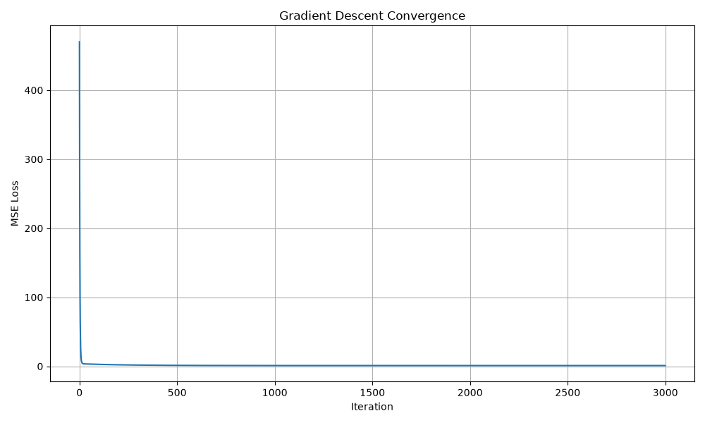

# Gradient Descent from Scratch

A from-scratch implementation of multi-feature linear regression trained
via manual gradient descent, no `model.fit()` shortcuts. Built to
demonstrate the underlying math (matrix operations, MSE loss, gradients,
parameter updates) rather than just library usage, and validated against
`scikit-learn`'s `LinearRegression` as a correctness check.

## What it does

* Generates a synthetic 3-feature regression dataset from known ground-truth
  parameters plus Gaussian noise; a local random generator leaves NumPy's
  global random state unchanged
* Implements the full training loop by hand: predictions, MSE loss,
  gradient computation, parameter updates over 3000 iterations
* Compares the learned parameters against both the true generating values
  and sklearn's closed-form solution
* Plots the MSE convergence curve over training

## Result

The from-scratch weights and bias converge to within ~0.0003 and ~0.005
of scikit-learn's `LinearRegression` fit on the same data. The regression tests
also check convergence and random-state isolation.



## Files

| File | Description |
|---|---|
| `gradient_descent_from_scratch.py` | Full implementation: data generation, training loop, sklearn comparison |
| `convergence_plot.png` | MSE loss vs. iteration |
| `notes.md` | Detailed write-up: concepts, math, findings |
| `test_gradient_descent.py` | Regression tests for convergence and reproducibility |
| `requirements.txt` | Runtime and test dependencies |

## Run it

```bash
python3 -m pip install -r requirements.txt
python3 gradient_descent_from_scratch.py
python3 -m pytest -q
```